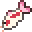
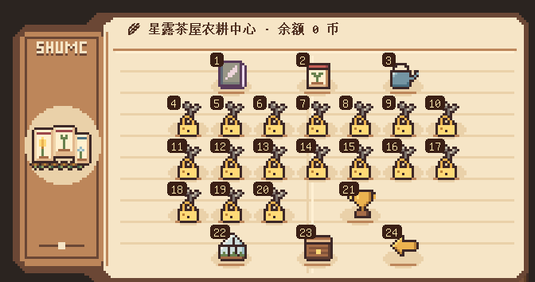

# SHUMC鼠鼠茶屋 · 新手百科

SHUMC鼠鼠茶屋 Minecraft 服务器的中文新手百科。纯静态网站（HTML + CSS + 少量 JS），**不需要任何构建步骤**，GitHub Pages 直接从 `main` 分支根目录发布。

网址（开启 GitHub Pages 后）：<https://imleyson.github.io/SHUMCwiki/>

## 目录结构

```
index.html          首页 · 前 10 分钟快速上手
route.html          新手成长路线：第一天 / 第一周 / 之后、每日每周清单、前期赚钱
town.html           主城与新手引导
economy.html        经济 · 茶屋币
jobs.html           职业专精与天赋
farming.html        农耕与牧场
fishing.html        钓鱼、图鉴与捕虫
seasons.html        四季与庆典
crafts.html         工坊 · 料理 · 锻造
recipes.html        配方与道具图鉴（工坊 17 配方、小吃、大餐、特产香料、合金、神器、家具速查）
adventure.html      冒险公会
social.html         社交 · 萌宠 · 许愿池
land.html           领地与家
commands.html       常用指令速查（只收玩家指令）
faq.html            常见问题、术语表、星级与品质对照
404.html            找不到页面时 GitHub Pages 显示的页面（用 <base href="/SHUMCwiki/">，所以链接都能用）
sitemap.xml         站点地图（新增页面时顺手加一行）
assets/css/site.css 全站样式（樱花茶屋像素风，色板取自材质包 menu_art.PIGMENTS）
assets/js/nav.js    页面清单：侧边栏顺序 + 站内搜索的页面范围
assets/js/site.js   侧边栏、页内目录、上一页/下一页、搜索、菜单图灯箱
images/brand/       pack.png（站点 logo 与 favicon）、og-card.png（分享链接时的预览图 1200×630）
images/art/         材质包 resource-pack/menu-art/ 里的菜单插画（侧边栏和卡片图标）
images/items/       材质包 assets/shumc/textures/item/ 里的物品、鱼、作物、昆虫贴图（32×32）
images/menus/       游戏菜单渲染图（只保留箱子部分，网页内嵌用）
images/menus/full/  同一菜单的完整渲染图（带每个按钮的悬停说明，点图时在灯箱里打开）
.nojekyll           让 GitHub Pages 原样发布文件
```

## 本地预览

搜索功能会用 `fetch` 读取各页面，所以请用本地服务器打开（直接双击 html 也能看，只是搜索不可用）：

```bash
python3 -m http.server 8000
# 然后访问 http://localhost:8000/
```

## 修改已有页面

直接编辑对应的 `.html` 文件里 `<main class="content">` 的内容即可，页头、侧边栏、页脚每页都一样，不用动。

- `<h2>` 是大章节，会自动出现在侧边栏的页内目录里；`<h2>`、`<h3>` 都会被搜索索引，并自动生成锚点 id（规则：标题文字里的空格和标点换成 `-`）。要固定锚点，可以手写 `id`。
- 常用写法（样式都在 `site.css` 里）：

```html
<code class="cmd">/sell</code>                     指令
<kbd>Shift</kbd>                                  按键
<div class="table-wrap"><table>…</table></div>    表格（窄屏可横向滚动）

<div class="callout tip">                         提示框：tip / warn / info
  
  <div><p class="c-title">标题</p><p>正文</p></div>
</div>

<div class="item-grid">                           物品格子
  <div class="item">
    <div><div class="i-name">樱花锦鲤</div><div class="i-sub">40–140 cm</div></div></div>
</div>                                            （加 class="item legend" 是金框，"item oddity" 是虚线框）

<figure class="menu-shot">                        游戏菜单图
  <a href="images/menus/full/farm_dex.png"></a>
  <figcaption>农耕中心（/farm） · <span class="zoom">点图看每个按钮的说明</span></figcaption>
</figure>
<div class="shots">…多个 figure 并排…</div>
```

- 像素图请加 `class="px"`（或放在上面这些组件里），浏览器会用 `image-rendering: pixelated` 放大，不会糊。

## 新增页面

1. 复制任意一个页面（例如 `land.html`）改名，比如 `events.html`；
2. 改 `<title>`、页头的图标 / 标题 / 简介，以及 `<main>` 里的内容；
3. 在 `assets/js/nav.js` 的 `SHUMC_NAV` 里加一行（顺序就是侧边栏顺序），图标可以用 `images/art/` 里任意一张：

```js
{ href: "events.html", title: "活动日历", icon: "images/art/lantern.png", desc: "一句话简介" },
```

侧边栏、上一页/下一页和搜索都会自动包含新页面。

4. `<head>` 里 `<!-- meta:start -->` 到 `<!-- meta:end -->` 之间是分享预览（Open Graph）和 canonical 标签，复制页面后把里面的标题、简介和网址改成新页面的；再在 `sitemap.xml` 加一行。
5. 改了页面清单或大改标题后，把 `assets/js/site.js` 里搜索缓存的 `shumc-search-v3` 版本号 +1，老访客的搜索才会立刻用上新内容。

## 图片从哪来

- **物品 / 鱼 / 作物 / 昆虫贴图**：复制自 SHUMC 仓库 `resource-pack/assets/shumc/textures/item/`，文件名和 `shumc:` 模型 id 一致（例如 `fish_koi.png`）。要加新图标，从那里复制到 `images/items/` 即可。
- **菜单插画**：复制自 `resource-pack/menu-art/`。
- **菜单渲染图**：用 SHUMC 仓库的 `plugin-src/tools/menu-preview`（本地 Paper 26.3 测试服 + 4 个插件 + MenuHarness 导出 `/tmp/menus.json`，再用 `render_menus.py` 画成 PNG）生成。渲染时的测试玩家是虚拟存档，所以图里的余额、等级、进度只是示例。插件菜单改版后，重新跑一遍工具，把对应 PNG 覆盖到 `images/menus/full/`；`images/menus/` 里的是裁掉右侧说明栏和下方空背包后的版本（宽 672 像素）。

只提交页面里真正用到的图片，没用到的可以删掉。

## 内容原则

- 只写**服务器上已经上线**的玩法；设计稿、路线图和未上线的内容不写。
- 数值以插件代码 / 游戏内菜单为准；插件改版后请同步更新对应页面。
- 只收玩家能用的指令，不写管理员指令和服务器运维信息。
- 服务器名称统一写「SHUMC鼠鼠茶屋」。

## 开启 GitHub Pages

仓库 Settings → Pages → Build and deployment：Source 选 **Deploy from a branch**，Branch 选 **main** / **/(root)**，保存。几分钟后访问 <https://imleyson.github.io/SHUMCwiki/>。
